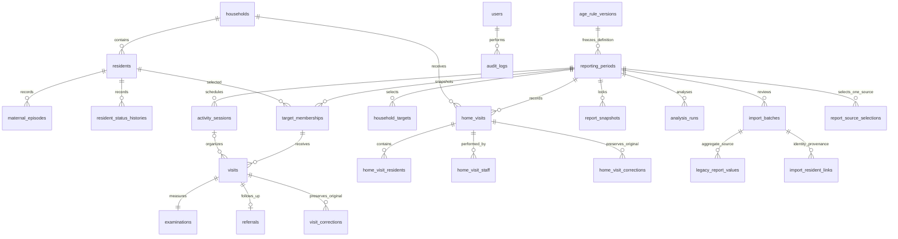

# Arsitektur dan kamus data

Modular monolith Laravel 13, React/TypeScript/Inertia, PostgreSQL. Controller/Form Request membatasi akses/input; service menangani transaksi; job provider hanya menerima ID internal. Tidak ada SQL bebas untuk pengguna atau agent AI.

Frontend memakai shadcn/ui radix-nova dengan base Taupe, tema dan chart Orange, heading/font Geist, Lucide, radius default 0.625rem, menu default/solid dan accent subtle. components.json mencatat registry/alias/menu; resources/css/theme.css memusatkan token terang/gelap. Button/Card/Badge/Input/DropdownMenu bersumber registry Nova resmi dan menggunakan dependensi Radix/CVA yang telah terpasang. Adapter components/ui.tsx mempertahankan kontrak komponen lama. cn berada di lib/utils.ts. Geist variable disajikan lokal, lisensi font pada resources/fonts/OFL.txt dan lisensi komponen pada components/ui/LICENSE.md. Tidak memuat font dari pihak ketiga ketika aplikasi dipakai.

## Identitas, kategori, dan waktu

Warga disimpan sekali. residents memuat registrasi unik, nama, gender, tanggal lahir nullable/estimasi, household_id, guardian_id, hubungan keluarga, alamat opsional, status, revision dan arsip. NIK/kontak opsional disimpan pada national_id_ciphertext/phone_ciphertext dengan encrypted cast. Keluarga menyimpan kepala keluarga, alamat, aktif/arsip, revision dan family_card_ciphertext terenkripsi. NIK/KK mempunyai keyed HMAC lookup hash dengan unique constraint termasuk data arsip. Kolom plaintext legacy dipindahkan ke ciphertext dan dikosongkan oleh migrasi aditif.

Semua ciphertext/hash disembunyikan dari serialisasi model. Detail warga/daftar keluarga hanya menambahkan nilai display tersamar; identity.reveal mengizinkan nomor lengkap dan pencatatan akses audit tanpa nilai nomor. Form kosong mempertahankan nilai existing; penghapusan eksplisit mengirim null. NIK/KK berupa string 16 digit, tidak diwajibkan. Validasi tidak mem-flash NIK/KK/kontak ke old input. Import/ekspor agregat dan evidence AI tidak memuat nomor tersebut.

maternal_episodes memakai jenis/start/end/source, bukan tabel warga terpisah. Episode jenis sama tidak boleh tumpang tindih. resident_status_histories mempertahankan status efektif.

age_rule_versions menyimpan enam batas bulan, versi/sumber/status sementara/pembuat. Versi immutable. reporting_periods menyimpan age_rule_version_id; target_memberships membekukan kategori, umur, gender dan tiga flag maternal pada reference_date. General mempertahankan usia belum diketahui/estimasi. Laporan terkunci tidak membaca kategori hidup saat ini.

Tanggal kalender menggunakan date; timestamp sistem UTC dan input/tampilan Asia/Jakarta. Pengukuran memakai decimal. Nama/kontak tidak masuk job payload atau bukti AI.

## Pelayanan dan kunjungan rumah

visits adalah kejadian, satu orang dapat berkunjung berulang. examinations memakai kolom bertipe untuk pengukuran dan kode hasil dari katalog terbatas ClinicalFields; bukan EAV/form engine universal. Hasil petugas dipisahkan dari nilai mentah dan wajib provenance bila diisi. Lima status pengukuran menjaga null berbeda dari nol/normal. Hasil sensitif disembunyikan dari serialisasi default.

referrals menyimpan tujuan/alasan/tanggal/status/catatan tindak lanjut per kunjungan. visit_corrections menyimpan versi asli terenkripsi saat final dibuka menjadi draft. home_visit_corrections menjalankan pola sama.

home_visits mempunyai keluarga, tanggal, alasan/tindak lanjut dan finalisasi. Pivot warga menyimpan kategori/maternal snapshot dan temuan terkontrol. Pivot staff mendukung beberapa petugas. household_targets unik periode/keluarga. Hitungan keluarga/warga/kejadian tidak disamakan.

## Mutasi, laporan dan sumber

PeriodWorkflow mengunci baris periode dan memeriksa revision/status sebelum semua mutasi sumber, termasuk kegiatan, rumah, import/rekonsiliasi dan koreksi. Submitted/locked menolak penulisan. ResidentRegistry memakai row lock/revision pada identitas; snapshot menjaga histori ketika identitas berubah.

OperationalReport dan GroupedReport menghasilkan dataset yang sama untuk tabel/snapshot/ekspor. ReportData memilih current atau snapshot versi yang diminta dan menyaring indikator sensitif sesuai izin. report_snapshots immutable menyimpan metrik lima rekap, aturan/mapping, revision/hash, waktu dan approver. Snapshot lama sebelum fitur diperluas tetap dibaca tanpa mengarang mapping baru.

ImportBatch menyimpan file privat, checksum, jenis/periode, draft_rows terenkripsi, revision, status/peninjau. Commit satu transaksi. legacy_report_values tidak menciptakan transaksi orang. report_source_selections memilih satu sumber per periode/jenis; tidak menjumlahkan legacy dengan transaksi. Snapshot menyimpan hasil pilihan sumber.

## Provider dan audit

analysis_runs menyimpan evidence allowlist agregat, lingkup kelompok, periode/revisi/hash utama dan pembanding, prompt/schema/model/source, status job, stale, hasil asli, review/revisi serta usage bila tersedia. GenerateAnalysis dan ExtractReportImage memeriksa lagi akun/izin/konfigurasi/sumber sebelum eksekusi. Perbandingan mensyaratkan versi usia/mapping/sumber sebanding. Mutasi salah satu periode menandai hasil stale. Model hanya menerima data yang diperlukan, bukan akses DB/tools.

Berkas asli privat di storage/app/private/imports. URL sumber memerlukan auth, izin, parent binding dan signature kedaluwarsa. XLSX dibaca tanpa menjalankan formula; ukuran isi ZIP dibatasi. Ekspor agregat memeriksa izin dan menetralkan awalan formula pada teks.

audit_logs mencatat aksi, resource ID, pelaku, waktu dan alasan administratif; tidak menyalin pengukuran, kata sandi atau rahasia. Private JSON koreksi dan draft import memerlukan APP_KEY existing; backup key dipisahkan secara aman.

Foreign key mempertahankan rekam layanan saat warga/akun diarsipkan. down() migrasi tambahan menghapus data modul baru dan bersifat destruktif; operasional memakai forward fix/restore teruji, bukan rollback massal.
